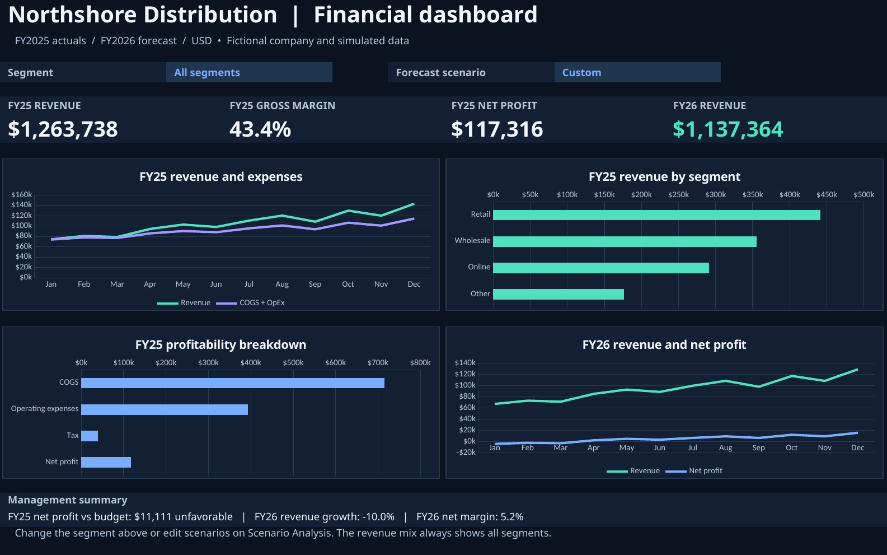

# Financial Performance & Forecasting Dashboard

An Excel FP&A case study for Northshore Distribution, a fictional distributor. All actuals, budgets and assumptions are synthetic. The model covers FY2025 actuals and budget and FY2026 monthly projections in USD.

## Dashboard previews

**Base** · All segments, revenue up 12% and OpEx up 6%.

**Custom stress case** · All segments, revenue down 10% and OpEx up 5%.

## Use the model

1. Download [the Excel workbook](financial-performance-forecasting.xlsx) and open it in desktop Excel.
2. On **Dashboard**, select a segment in cell **D5**. The financial statements, budget comparison, forecast and scenario results update for that segment. The revenue mix chart retains the company-wide view.
3. On **Scenario Analysis**, choose a scenario in **B5**. Edit the blue assumption cells to test another case. The Custom row starts with revenue down 10% and operating expenses up 5%.
4. Review the monthly results on **Forecast** and compare annual results for all four cases on **Scenario Analysis**. Confirm that **Model Checks** shows **PASS** after changing the controls.

| Tab | Contents |
| --- | --- |
| Dashboard | Revenue, gross margin, net profit, forecast revenue, four charts and a management summary |
| Raw Data | 48 editable month-by-segment observations with actuals and budget |
| Financial Statements | Monthly and annual income statement with calculated margins |
| Budget vs Actual | Monthly and annual dollar variance for revenue, COGS, OpEx and net profit |
| Forecast | Monthly FY2026 income forecast driven by scenario inputs |
| Scenario Analysis | Four editable cases and their monthly calculation detail |
| Model Checks | Live monthly and annual reconciliations across source data, reports, and the active scenario |

## Forecast methodology and limitations

The Base case uses **12% revenue growth** as an illustrative planning assumption for a distributor targeting double-digit growth. It provides a reference point between the **20% Upside** and **−10% Downside** cases. With one year of synthetic monthly observations, the model has no historical year-over-year growth rate to estimate or validate that assumption.

The forecast applies the same selected growth rates to each prior-year month, preserving FY2025 revenue and operating expense seasonality. In Base, each month's COGS percentage and the editable 25% tax rate carry forward, while OpEx rises 6%. The model uses one set of scenario inputs across all segments and omits financing costs, working capital, capital spending and debt schedules. It forecasts income and profitability only. Cash flow, liquidity and balance sheet effects require a linked three-statement model.

## Management recommendation

Across all segments, FY2025 revenue was **$1.264M** with a **43.4% gross margin** and **$117.3K net profit**. Net profit was **$11.1K below budget**. Operating expenses were **$14.0K over budget**, the largest unfavorable line among revenue, COGS and OpEx. Start by requesting general-ledger detail and comparing freight surcharges, warehouse overtime and third-party service fees with budget by month. The synthetic data aggregates OpEx, so these are investigation targets. If the detail supports them, consolidate shipments, adjust staffing to order volume, and rebid recurring vendor contracts.

Base-case FY2026 revenue is **$1.415M**, up **12.0%**, with **$149.1K** in net profit. In the Custom stress case, forecast net profit falls to **$58.9K**, about **$90.1K below Base**. In Base, **$10K of annual OpEx savings** would raise forecast pre-tax profit by **$10K** and net profit by **$7.5K** to approximately **$156.6K**, assuming unchanged sales and COGS, positive monthly operating profit, and a 25% tax rate. Track the savings against service levels and monthly variances.

See the [data dictionary and modeling assumptions](MODEL_NOTES.md) for formula definitions, scenario inputs and model conventions.

## Résumé bullets

- Built a seven-tab Excel FP&A workbook that integrates 48 synthetic month-by-segment observations into an interactive dashboard and budget variance report.
- Developed a 12-month, four-scenario forecast with editable revenue, cost and tax assumptions to quantify profitability under different operating conditions.
- Automated segment and monthly reporting with Excel Tables, SUMIFS, INDEX/MATCH, dropdowns and linked charts. Added live controls that flag discrepancies in monthly actuals, scenario inputs and forecast outputs.
