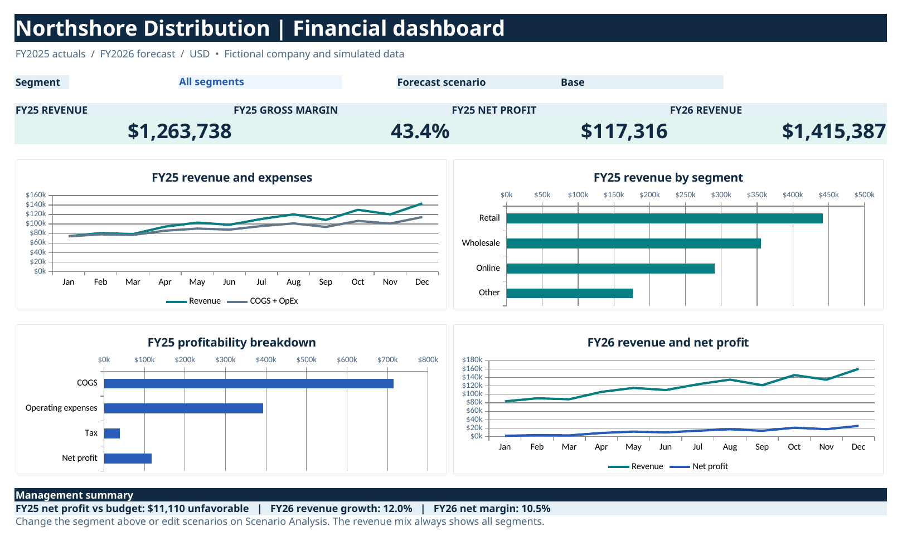

# Financial Performance & Forecasting Dashboard

An Excel FP&A case study for Northshore Distribution, a fictional distributor. All actuals, budgets and assumptions are synthetic. The model covers FY2025 actuals and budget and FY2026 monthly projections in USD.

## Use the model

1. Download [the Excel workbook](financial-performance-forecasting.xlsx) and open it in desktop Excel.
2. On **Dashboard**, select a segment in cell **D5**. The financial statements, budget comparison, forecast and scenario results update for that segment. The revenue mix chart retains the company-wide view.
3. On **Scenario Analysis**, choose a scenario in **B5**. Edit the blue assumption cells to test another case. The Custom row starts with revenue down 10% and operating expenses up 5%.
4. Review the monthly results on **Forecast** and compare annual results for all four cases on **Scenario Analysis**.

| Tab | Contents |
| --- | --- |
| Dashboard | Revenue, gross margin, net profit, forecast revenue, four charts and a management summary |
| Raw Data | 48 editable month-by-segment observations with actuals and budget |
| Financial Statements | Monthly and annual income statement with calculated margins |
| Budget vs Actual | Monthly and annual dollar variance for revenue, COGS, OpEx and net profit |
| Forecast | Monthly FY2026 income forecast driven by scenario inputs |
| Scenario Analysis | Four editable cases and their monthly calculation detail |

## Management summary

Across all segments, FY2025 revenue was **$1.264M** with a **43.4% gross margin** and **$117.3K net profit**. Net profit was **$11.1K below budget**. Operating expenses were **$14.0K over budget**, the largest unfavorable line among revenue, COGS and OpEx. That makes OpEx the first place to investigate.

Base-case FY2026 revenue is **$1.415M**, up **12.0%**, with **$149.1K** in net profit. In the Custom stress case, forecast net profit falls to **$58.9K**, about **$90.1K below Base**. The sensitivity suggests reviewing which operating expenses can adjust if revenue falls.

See the [data dictionary and modeling assumptions](MODEL_NOTES.md) for formula definitions, scenario inputs and model conventions.

## Résumé bullets

- Built a six-tab Excel FP&A workbook that integrates 48 synthetic month-by-segment observations into an interactive dashboard and budget variance report.
- Developed a 12-month, four-scenario forecast with editable revenue, cost and tax assumptions to quantify profitability under different operating conditions.
- Automated segment and monthly reporting with Excel Tables, SUMIFS, INDEX/MATCH, dropdowns and linked charts.
